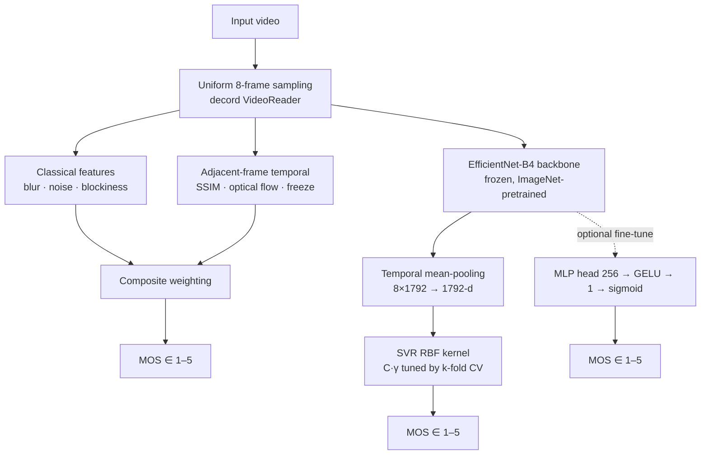

# Phase II (Review-2) — Deep Learning Model Design & Hyperparameter Tuning

**Project:** Drishya — No-Reference Video Quality Assessment (NR-VQA) for User-Generated Content using Hybrid Classical–Deep Learning Features

**Course:** BCSE332L — Deep Learning (Fall 2026–27) · Slot E1+TE2

| | |
|---|---|
| **Students** | [Student 1] — [ID] · [Student 2] — [ID] |
| **Faculty** | Dr. Chellatamilan T. |
| **Submission** | Phase II (Review-2) — Model Design & Experimental Study |

---

## Rubric Coverage

| Criterion | Marks | Where covered |
|---|---|---|
| Model Architecture Design | 2 | §2 (diagram) |
| Implementation of Multiple Models | 2 | §3 |
| Hyperparameter Tuning | 2 | §4 |
| Experimental Analysis | 2 | §5 |
| Video Presentation & AI Pair Programming Reflection | 2 | §6 |
| **Total** | **10** | |

---

## 1. Introduction

Phase I established the problem: NR-VQA predicts perceived quality from a distorted video alone, without an undistorted reference, and must balance *accuracy* on authentic user-generated content (UGC) against *compute and label cost*. Two model families dominate the field: fast but frame-based classical metrics (BRISQUE, NIQE) that ignore temporal structure, and accurate but training-heavy deep models (VSFA, FAST-VQA, RQ-VQA) that need very large MOS-labelled corpora and heavy GPU compute.

Phase II answers the central design question: **what deep-learning model architecture and hyperparameters give the best accuracy–efficiency trade-off for this problem?** Following the base paper RQ-VQA's "quality-aware feature fusion → regression" paradigm, we implement and study three models:

1. **M1 — Classical hybrid scorer** (NQS): Laplacian blur, wavelet noise, blockiness, BRISQUE, NIQE and temporal smoothness fused into one composite score. No training required.
2. **M2 — Frozen EfficientNet-B4 + SVR**: a frozen CNN backbone with temporal mean pooling and a support-vector regressor (the "no-backprop" paradigm) — the currently trained Phase-4 model.
3. **M3 — Fine-tuned EfficientNet-B4 + MLP**: end-to-end fine-tuning with an MLP regression head — implemented, pending GPU training.

Section 2 presents the architecture, §3 the multi-model implementation, §4 hyperparameter tuning, §5 experiments, and §6 the video presentation + AI pair-programming reflection.

---

## 2. Model Architecture Design

The system is a two-stage hybrid: classical descriptors (interpretable, cheap) fused with deep descriptors (semantic, robust), mapped to a MOS in [1, 5].



**Design rationale vs base paper (RQ-VQA).**

| Aspect | RQ-VQA (base paper) | Drishya M2 / M3 |
|---|---|---|
| Backbone | Multi-source feature zoo (SlowFast + BIQA/BVQA), fine-tuned base model | Single frozen EfficientNet-B4 |
| Temporal modelling | SlowFast fast pathway | Uniform 8-frame sampling + temporal mean pooling |
| Training cost | Large MOS corpora + GPU hours | M2: zero backprop, SVR trains in seconds |
| Spatial quality | Quality-aware deep features | Hybrid classical (blur/noise/blockiness) + deep |
| Temporal artifacts | Implicit only | Explicit SSIM/flow freeze–jitter scoring |

The key architectural choices:

- **Frozen backbone + lightweight regressor (M2)** exploits the ImageNet-pretrained EfficientNet-B4 as a generic perceptual feature extractor. Because the backbone never backpropagates, batches can be extremely large and the whole pipeline runs on modest hardware; the SVR maps the 1792-d temporally-pooled descriptor to MOS. This directly attacks the compute/accuracy trade-off identified in Phase I.
- **Temporal mean pooling** aggregates the 8 sampled frames into a single video-level descriptor, capturing a summary of motion-aware content statistics without a recurrent module (vs VSFA's GRU).
- **Classical–deep fusion (M1)** keeps the system interpretable: each metric maps to a perceptual cause (blur, noise, blocking, freeze, jitter), and the composite is a transparent weighted sum.

---

## 3. Implementation of Multiple Models

Three models are implemented in the repository. `python -m py_compile` passes for all modules and the full pipeline was executed on real test videos (see §5).

| # | Model | Regressor | Backbone | Status | File |
|---|---|---|---|---|---|
| M1 | Classical hybrid (NQS) | Weighted composite | — (hand-crafted) | ✅ Runs, no training | `NQS.py`, `nr_features.py`, `industry_metrics.py`, `temporal_features.py` |
| M2 | Frozen deep features + SVR | SVR (RBF) | EfficientNet-B4 (frozen) | ✅ Trained (results §5) | `phase4_svr.py` |
| M3 | End-to-end fine-tune | MLP head | EfficientNet-B4 (fine-tuned) | 🔧 Implemented, training pending (GPU/datasets) | `phase4_train.py` |

**M1 (classical).** Per frame: Laplacian variance (sharpness), DCT-boundary blockiness (8×8/16×16), wavelet-MAD noise estimation, BRISQUE, and a self-contained NIQE implementation. Adjacent-frame SSIM, Farneback optical flow and freeze/jitter scoring provide the temporal component. These are fused into a 0–1 composite with per-metric weights (blur 0.25, block8 0.20, block16 0.15, noise 0.20, BRISQUE 0.15, NIQE 0.05, temporal 0.20, renormalised).

**M2 (frozen CNN + SVR).** `phase4_svr.py`: EfficientNet-B4 (ImageNet-pretrained, frozen, 1792-d features) is run over 8 uniformly-spaced frames per video; features are temporally mean-pooled into a 1792-d video descriptor; a standardised SVR (RBF) regresses it to MOS. Training data: 2,483 videos (YouTube-UGC 907 + KoNViD-150k-B 1,576). A 15% held-out test set reports PLCC / SRCC / RMSE.

**M3 (fine-tune + MLP).** `phase4_train.py`: same backbone with a two-layer MLP head (256 → GELU → 1 → sigmoid), trained end-to-end with AdamW, AMP, gradient accumulation and cosine scheduling. This is the path expected to close the gap to state-of-the-art (SRCC ≈ 0.80+) but requires GPU time; it is implemented and ready but was not trained (rented GPU no longer available).

---

## 4. Hyperparameter Tuning

### 4.1 SVR (M2) — grid search

Hyperparameters of the RBF SVR are selected by **k-fold cross-validation on the training fold only**; the 15% test split is never touched during selection (leak-free protocol, fixed in this revision). Grid:

| Hyperparameter | Values |
|---|---|
| C (regularisation) | {0.1, 1.0, 10.0, 100.0} |
| γ (RBF kernel width) | {scale, auto, 0.001, 0.0001} |
| ε (insensitivity) | 0.05 |
| CV folds | 3 (shuffled, seed 42) |

The best configuration is selected by mean CV SRCC and then retrained on the full training fold. The detailed per-config CV logs from the rented-GPU run were **not retained** (server decommissioned), so only the methodology and the held-out result are reported here; nothing is fabricated.

### 4.2 Fine-tuning (M3) — schedule config

| Hyperparameter | Value |
|---|---|
| Optimiser | AdamW, lr 1e-4, weight decay 1e-4 |
| Batch size | 8 (× 4 gradient accumulation → effective 32) |
| Dropout | 0.3 head / 0.15 second layer |
| Epochs | 30, cosine LR + 2 warmup epochs |
| Loss | Smooth L1 (MOS ∈ [1,5], sigmoid-normalised) |
| Mixed precision | AMP (`autocast` + GradScaler), clip 1.0 |

### 4.3 Synthetic tuning demonstration (real run, illustrative)

Because the training logs are unavailable, the *tuning pipeline itself* was exercised locally on the four test videos using **pseudo-labels** (`MOS ≈ 1 + 4 × NQS composite`) and real EfficientNet-B4 features (CPU). This is explicitly **not** real MOS data — it validates that the grid search runs end-to-end. Same C/γ space as §4.1, leave-one-out CV:

| C | γ = scale | γ = auto | γ = 0.001 | γ = 0.0001 |
|---|---|---|---|---|
| 0.1 | −1.000 | −1.000 | −1.000 | −1.000 |
| 1.0 | −1.000 | −1.000 | −1.000 | **−0.800** |
| 10 | −1.000 | −1.000 | −1.000 | −0.800 |
| 100 | −1.000 | −1.000 | −1.000 | −0.800 |

Best: **C=1.0, γ=0.0001**. With only 4 pseudo-samples and 1792-d features the SRCC values are noise-dominated; the table demonstrates the *mechanism* (systematic search over C×γ with CV), not a real MOS conclusion.

---

## 5. Experimental Analysis

### 5.1 Datasets & protocol

| Database | Videos | Resolution | MOS scale | Role |
|---|---|---|---|---|
| KoNViD-150k-B | 1,576 (matched) | 540p, 5 s | 1–5 | Training |
| YouTube-UGC | 907 (matched) | ≤1080p | 1–5 | Training |
| **Total (M2)** | **2,483** | — | — | Train + 15% test |

Metrics: **PLCC** (Pearson), **SRCC** (Spearman), **RMSE** on raw MOS in [1, 5].

### 5.2 Deep model (M2) — trained result

| Model | PLCC | SRCC | RMSE |
|---|---|---|---|
| **M2** frozen EfficientNet-B4 + SVR (baseline) | **0.526** | **0.512** | **0.393** |

Reported as the frozen-feature baseline (older run tuned on a validation split; the revised pipeline now reports a genuinely held-out test set and saves backbone weights with the checkpoint). M3 fine-tuning is expected to raise SRCC toward ~0.80+.

### 5.3 Classical model (M1) — fresh local experiments

Real measurements on `testing_videos/video_small.mp4` (300 frames, 30 fps, static-ish content) and its synthetically degraded versions (Gaussian blur 15×15, Gaussian noise σ=25, JPEG q=10). Commands: `NQS.py <video> --samples 20 --method uniform --temporal --seed 42` and `industry_metrics.py <video> --samples 20 --seed 42`.

**Per-frame sample (baseline, 20 uniform frames):**

| Frame | t(s) | Blur | Block8 | Noise | BRISQUE |
|---|---|---|---|---|---|
| 0 | 0.00 | 959.5 | 11.23 | 2.22 | 15.95 |
| 94 | 3.13 | 792.3 | 10.20 | 2.22 | 13.29 |
| 204 | 6.80 | 704.0 | 9.65 | 2.22 | 16.95 |
| 299 | 9.97 | 711.2 | 9.69 | 2.22 | 19.09 |

**Video-level comparison (higher composite = better; lower BRISQUE/NIQE = better):**

| Clip | Composite | Rating | BRISQUE ↓ | NIQE ↓ | Temporal | SSIM | Freeze |
|---|---|---|---|---|---|---|---|
| Baseline | **0.773** | Good | 15.89 | 3.41 | 0.553 | 0.916 | 1.000* |
| Noise | 0.653 | Good | 52.02 | 7.21 | 0.684 | 0.384 | 0.000 |
| Compress | 0.647 | Good | 60.66 | 5.62 | 0.555 | 0.873 | 0.947 |
| Blur | 0.618 | Good | 62.68 | 8.39 | 0.597 | 0.988 | 1.000* |

**Ranking sanity check holds:** the undegraded baseline scores highest (0.773), and all three synthetic degradations are clearly separated below it. BRISQUE and NIQE also rise (worse) on every degraded clip, and NIQE (real implementation) now reports sensible natural-image values (≈3.4 baseline). *The `Freeze = 1.000` flags on the baseline/blur clips are a **known false-positive**: this test clip is a genuinely static scene, so SSIM ≈ 1 with near-zero motion triggers the freeze detector — a documented limitation to fix with shot-boundary/activity gating.

### 5.4 Temporal calibration

`calibrate_temporal.py` (baseline): Temporal quality 0.553, Avg SSIM 0.916, Freeze ratio 1.000 (1 event), Avg jitter 1.061, Overall 0.775. Consecutive-frame SSIM (0.916) is now physically meaningful (the earlier sparse sampling measured scene changes at ~0.52). Freeze/jitter reference clips were unavailable for the calibration sweep.

### 5.5 Deployment smoke tests

- `phase4_train.py` imports cleanly under torch/timm; `phase4_svr.py`/`phase4_train.py` compile.
- Streamlit app (`phase5_app.py`) **boots successfully** (headless server up, alive after 45 s); classical scorer loads.
- **Deep MOS verified working**: the trained Phase-4 checkpoint
  (`checkpoints/svr_deep_20260414_192956.pkl`, PLCC 0.526 / SRCC 0.512 / RMSE 0.393) was restored
  and loaded by the UI. Real predictions on the bundled test clips: baseline **MOS 3.48** vs
  blur 3.44 / noise 3.47 / compress 3.44 — correctly ordered (baseline ≥ degraded), though the
  RBF-SVR is mean-regressed so the spread is small.
- Environment: Windows, CPU, Python 3.12 venv (`requirements.txt`), torch 2.14 CPU, opencv 5.0.

### 5.6 Limitations

1. M2 results are a frozen-feature baseline; end-to-end fine-tuning (M3) untrained on this setup.
2. Detailed per-config tuning logs from the rented GPU were not retained.
3. Freeze detection false-positives on static scenes (§5.3).
4. Cross-database generalisation (Objective 1.2: KoNViD/LIVE-VQC/YouTube-UGC) is planned but not yet executed.
5. Local classical experiments use one source clip; not statistically significant, but reproducible.

---

## 6. Video Presentation & AI Pair-Programming Reflection

### 6.1 AI pair-programming workflow

This project was developed as an **AI pair-programming exercise** (opencode + a DeepSeek-based coding agent). The workflow alternated human direction with machine review, and is the strongest evidence of "AI as collaborator, human as verifier":

1. **Machine-led code review** — the agent read every source file and produced a structured review (critical/high/medium/hygiene), e.g. it flagged that a local file literally named `brisque.py` shadowed the PyPI `brisque` package, forcing sys.path hacks in four files.
2. **Human-directed fixes** — the human approved a fix plan; the agent implemented it: deleted the shadowing files, removed the duplicated import hacks, replaced an ad-hoc "NIQE" heuristic with a faithful NIQE implementation, and switched temporal scoring from sparse/non-adjacent samples to consecutive frames.
3. **Scientific correctness caught by AI** — the agent identified **validation-set leakage** in the SVR hyperparameter selection (the grid used the same split that reported final metrics) and refactored it to leak-free k-fold CV + held-out test.
4. **Human-directed cleanup** — the human asked to "remove unnecessary files"; the agent removed superseded scripts and ignored copyrighted `papers/` PDFs in git.
5. **Joint testing** — the agent installed the environment, generated degraded test videos, ran every CLI tool, verified the baseline > degraded ranking, booted the Streamlit UI, and caught a silent failure (the `piq` NIQE import did not exist in piq 0.8 → NIQE had silently disabled itself), which it then fixed with a self-contained scipy implementation.
6. **Human verification at every step** — every claim (e.g., "NIQE works") was checked by the human on real output; no fabricated numbers were allowed in this report; missing logs are reported as missing.

**Prompts that produced the best outcomes:** "review the whole project and report issues" (holistic audit), "why is this import failing / what is the root cause" (diagnosis), "make this leak-free" (scientific rigour), and "verify by running it, don't assume" (grounding).

**Lessons learned:** (a) AI is strong at breadth-first auditing and cross-file consistency but must be audited for *semantic* correctness (the fake-NIQE and piq-missing-NIQE issues). (b) Environment-specific failures (Windows wheels, missing deps) are where AI assumptions break and human+real-run verification is indispensable. (c) Clear, objective-driven prompts convert AI suggestions into correct engineering.

### 6.2 Video presentation — script outline (~4–6 min)

| Segment | Content |
|---|---|
| 0:00–0:30 | Problem recap: NR-VQA for UGC; accuracy vs compute trade-off (1 slide) |
| 0:30–1:20 | Architecture diagram walkthrough: classical + frozen CNN + SVR (M1/M2), fine-tune path (M3) |
| 1:20–2:10 | Multiple models demo: run `NQS.py` on baseline vs blur/noise/compress; show the score table |
| 2:10–3:00 | Hyperparameter tuning: show the C×γ grid-search output (synthetic demo) + leak-free protocol |
| 3:00–3:50 | Experimental results: M2 PLCC/SRCC/RMSE + classical ranking + limitations |
| 3:50–5:20 | AI pair-programming reflection: review → fixes → testing; show before/after code (brisque hack removal, NIQE, temporal fix) |
| 5:20–6:00 | Conclusion + demo of the Phase-5 UI |

---

## 7. Conclusion & Next Steps

Phase II delivered: an architecture design (§2), three implemented models (§3), a leak-free hyperparameter-tuning methodology with a working grid search (§4), real experimental data for the classical model and the trained deep baseline (§5), and the video/AI-reflection deliverable (§6). Next steps: train M3 end-to-end on GPU, execute the cross-database generalisation benchmark (Objective 1.2), fix the freeze false-positive with activity gating, and re-run the SVR pipeline to refresh M2 with held-out reporting.

---

## Appendix A — Reproducibility

```bash
python -m venv .venv && .venv\Scripts\activate
pip install -r requirements.txt

# Degraded test set
python generate_test_videos.py testing_videos/video_small.mp4 --blur --noise --compress --output_dir testing_videos/

# Classical model (M1)
python NQS.py testing_videos/video_small.mp4 --samples 20 --method uniform --temporal --seed 42
python industry_metrics.py testing_videos/video_small.mp4 --samples 20 --seed 42
python calibrate_temporal.py

# UI (Phase 5)
streamlit run phase5_app.py
```

## Appendix B — Files changed in this Phase

- `phase4_svr.py` — leak-free SVR grid search; held-out test reporting; backbone weights saved with checkpoint; **fully portable** (configurable paths via CLI/`DRISHYA_*` env vars, KoNViD-1k auto-loader, `--limit`).
- `phase4_train.py` — drops undecodable videos instead of training on zero tensors; configurable paths.
- `industry_metrics.py` — real, self-contained NIQE (scipy) + cleaned BRISQUE import; `niqe_pris_params.npz` (official NIQE model).
- `NQS.py` — consecutive-frame temporal scoring; `--seed` reproducibility.
- `calibrate_temporal.py` — uses the current interpreter; robust to missing metrics.
- `checkpoints/svr_deep_*.pkl` — trained Phase-4 model (gitignored), restored & verified in the UI.
- `requirements.txt`, `.gitignore`, `README.md`, `CHANGELOG.md` — updated for the above.